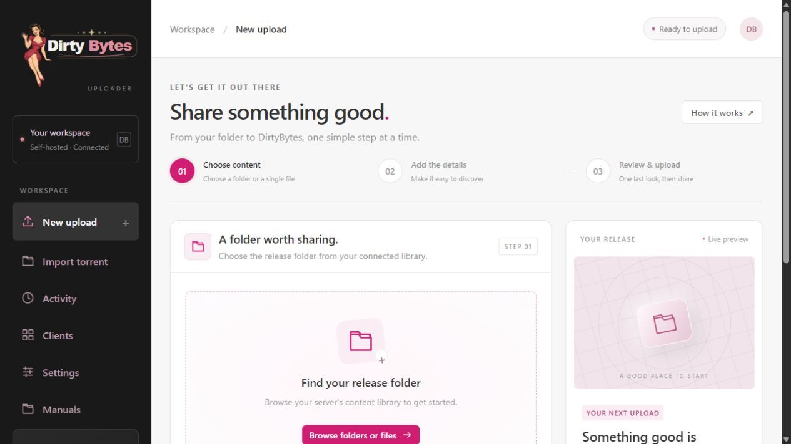
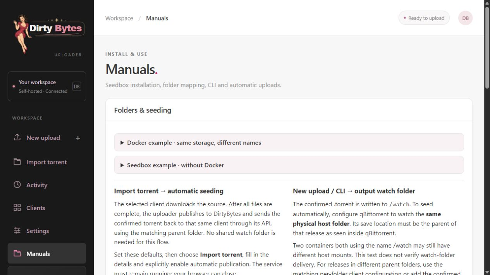
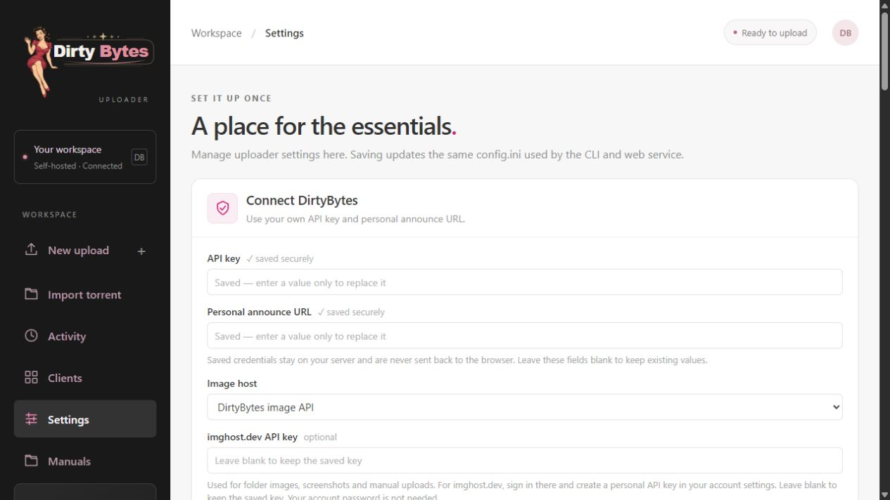
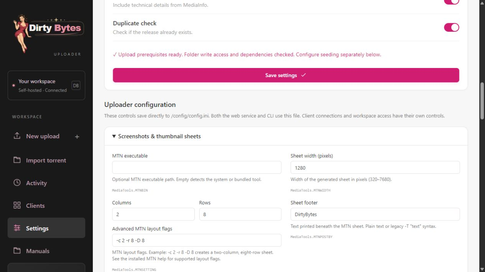
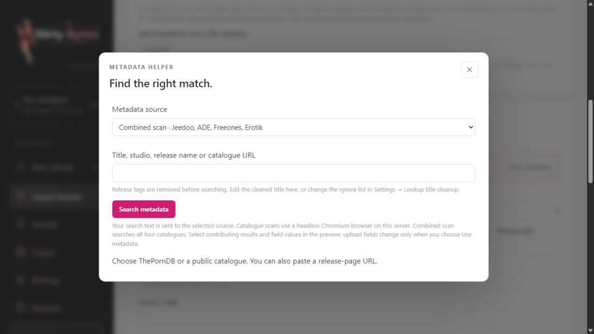

# Install with Docker

## Web interface

An empty upload workspace and the built-in installation and seeding guide.





### Settings & automation



### Screenshots & thumbnail sheets



### Metadata search



The complete Linux amd64 image contains Python, Chromium for catalogue lookups,
FFmpeg, MediaInfo, mkbrr, MTN, UnRAR and rar2fs.

## Docker Compose installation

Requires Docker Compose v2 and an amd64 / x86_64 host. Create a directory for the
uploader and its persistent files:

```bash
mkdir -p dirtybytes-uploader/workspace/{config,data,tmp,logs,watch,mounts}
cd dirtybytes-uploader
```

Save this as `compose.yaml`. Replace `/srv/media` with your media folder and
`1000:1000` with your account's UID:GID (run `id` to find them). The workspace
directories must be writable by that account.

```yaml
services:
  uploader:
    image: ghcr.io/digicore404/dirtybytes-uploader:latest
    init: true
    user: "1000:1000"
    shm_size: 256m
    restart: unless-stopped
    ports:
      - "6080:6080"
    environment:
      DIRTYBYTES_CONFIG: /config/config.ini
      DIRTYBYTES_WEB_PASSWORD: ${WORKSPACE_PASSWORD:?Set WORKSPACE_PASSWORD in .env}
    volumes:
      - /srv/media:/content
      - ./workspace/config:/config
      - ./workspace/data:/app/data
      - ./workspace/tmp:/app/tmp
      - ./workspace/logs:/app/logs
      - ./workspace/watch:/watch
      - ./workspace/mounts:/mounts
```

Create `.env` beside `compose.yaml`, choosing your own password of at least 12
characters. Use single quotes to keep special characters literal:

```dotenv
WORKSPACE_PASSWORD='replace-with-your-own-long-password'
```

Start the uploader:

```bash
docker compose up -d
```

Open `http://<server-ip>:6080` and sign in as `admin` with that password.
Configure your site credentials, upload preferences in **Settings**, and choose an **Settings → Image host** in its own panel.
Configuration and history stay in `workspace`. The password in `.env` initializes
the login only; change an existing login in **Settings → Workspace access**.

To update, from the same directory:

```bash
docker compose pull uploader
docker compose up -d --no-deps uploader
```

`latest` follows stable releases. Keep your existing workspace mounts when updating.
For CLI commands, use `docker compose run --rm uploader check` or
`docker compose run --rm uploader upload /content/My.Release --cat CATEGORY_ID`.
Use the appropriate category ID for your release.

## Which settings go where?

| Location | Purpose |
| --- | --- |
| `compose.yaml` | Image, media/workspace mounts, UID/GID and listening port |
| `.env` | Initial workspace password |
| Web Settings | DirtyBytes key/announce, screenshots/MTN, images, metadata, upload options |
| Web Clients | qBittorrent connections and paths visible to those clients |
| Web Workspace access | Active username/password and allowed IPs; stored in private SQLite |
| `workspace/config/config.ini` | Written by Settings and shared with the CLI |

An existing login is preserved on restart. Editing the initial password in `.env`
does not replace a login already saved in SQLite. Rerunning setup preserves it.
`config.ini`, `.env`, databases, browser sessions and logs are private: do not share
them or commit them. Back up the state directory privately.

## Storage and qBittorrent

The uploader sees your media folder at `/content`, read/write so it can create a release folder and link beside a selected single file. Existing media files stay in place. Your download client needs
write access to that same physical storage through its own mount. For example:

| Component | Path |
| --- | --- |
| Host media directory | `/srv/media` |
| Uploader | `/content` |
| qBittorrent | `/downloads` |

Configure import roots `/content` and `/downloads` in Settings. A new import is
placed directly at `/content/My.Release` (qBittorrent: `/downloads/My.Release`).
Existing target folders generate an error. No extra import or hash folder is made.
Use the built-in path check before publishing. A remote client requires shared
storage; an API connection alone does not make its files readable on this server.

All runtime files live below `workspace`: `config`, `data` (SQLite and exported
source torrents), `tmp`, `logs`, `watch` and `mounts`. Keep these directories private.
Completed torrents appear in `/watch`; alternatively use the configured client
delivery. Manuals in the app explain qBittorrent's completed-download command.

## UNRAR / rar2fs (optional)

The image includes both tools, but archive mounting additionally requires the
host's FUSE support. This feature is off by default. Extracted media can always be
uploaded normally. To mount RAR files without extracting them:

1. Ensure the host supplies `/dev/fuse` and FUSE user mounts. Your provider may need
   to enable this. Some NAS configurations do not support mount propagation.
2. An administrator must prepare `workspace/mounts` as a **shared host mount**.
   For a dedicated application directory, the Linux commands are
   `mount --bind /srv/uploader/mounts /srv/uploader/mounts` then
   `mount --make-rshared /srv/uploader/mounts`. Replace the path with your chosen
   state directory. Configure persistence with your host's mount manager.
3. The optional `compose.unrar.yaml` override and `setup.sh --unrar` helper are
   available in the repository for this advanced setup. They add the FUSE device,
   `SYS_ADMIN`, AppArmor allowance and shared propagation from `compose.unrar.yaml`.
   The script checks prerequisites; it never changes host mount propagation itself.
   It also creates synthetic container passwd/group files for your numeric UID/GID;
   your host's user database is never mounted into the container.
4. Enable **Settings → Archive handling (UNRAR / rar2fs)**. `/mounts` is the
   container's archive mount root; it is separate from `/content`.
5. A qBittorrent container seeding the unpacked view must also mount the host's
   `workspace/mounts`, e.g. at `/unpacked`, with `rslave` propagation. Configure
   its save path to that unpacked release, or watch folder delivery accordingly.
   Keep the uploader/FUSE mounts running for as long as that data is being seeded.

Ordinary media imports edit the original torrent using mkbrr and keep its piece
hashes. Unpacked RAR contents differ from the original archive payload, so they
require a new torrent and hashing. Archive-to-unpacked seeding needs the additional
path mapping above; the ordinary import-root mapping is not sufficient.

## Update, logs and CLI

```bash
docker compose pull uploader
docker compose up -d --no-deps uploader
docker compose logs --tail 100 uploader
docker compose run --rm uploader check
```

Updates preserve mounted configuration and history. `latest` tracks stable releases;
`edge` tracks main. You can pin the image in `compose.yaml` to a specific version
when you want to keep that release.

Third-party tool licences are retained in `bin`. The image includes the rar2fs
and UnRAR licences, corresponding source archives and build script under
`/usr/local/share/dirtybytes-archive`. Source versions and SHA-256 checks are
pinned in `scripts/build-archive-tools.sh`.

To recover access, stop the web service and set `[Web] USERNAME` and a nonempty `PASSWORD` (12–256 characters) in the mounted config.ini. Start the service again: the login is replaced once and PASSWORD is cleared from the INI. This works with existing accounts; editing the bootstrap password in .env does not reset an existing login.

Update notifications and installation-specific instructions are available in the web interface under **Settings → Uploader updates**. `latest` follows stable releases; `edge` follows main. Finish active uploads before recreating the uploader container, and keep its existing configuration and data volumes.
